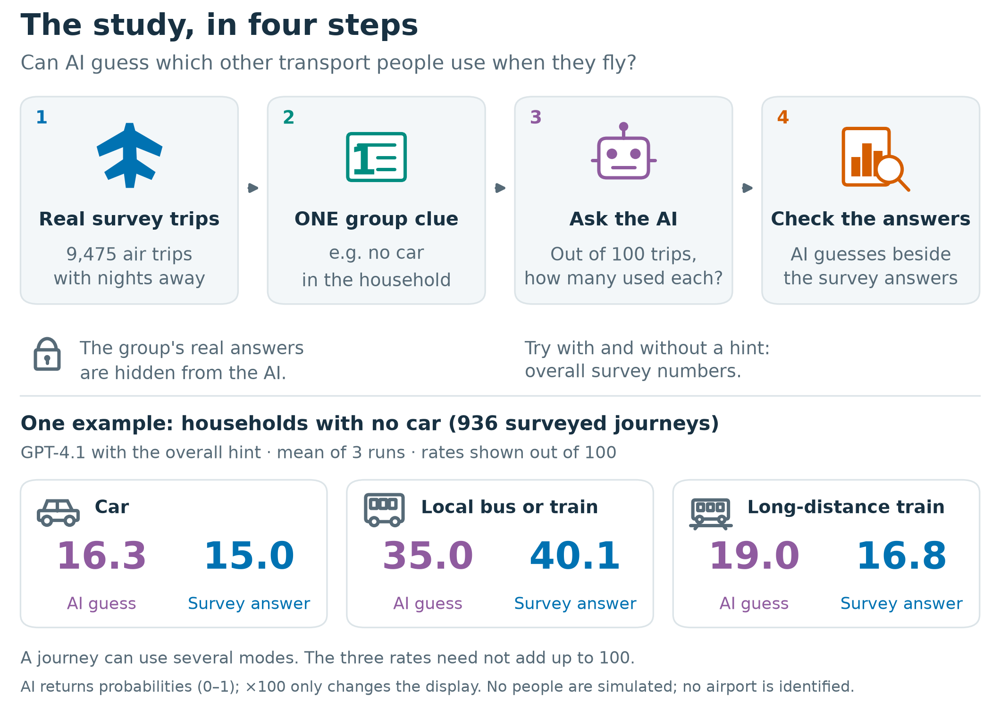

# What we did, in plain language

We asked: **Can an AI estimate how often different groups of air journeys also involve a car, local public transport or a long-distance train?** We checked its estimates against an existing survey.

Think of a card that says: **“An overnight air journey made by someone whose household has no car.”** The AI sees this one clue. We ask for three estimates, then compare them with the survey's answers for that group.

## 1. Start with journeys people already reported

- The public MiD 2023 tables we use contain **9,475 reported overnight journeys with aircraft as recorded main mode**.
- One person may have reported several journeys. These are journey records, not 9,475 different passengers.
- We use published group percentages. We have no individual B1 records and collect no new survey responses.

## 2. Make cards with one clue each

- We considered **14 attributes**, including age, household cars, income, residential area, journey purpose and nights away.
- We decided to select **two traveller attributes and two journey attributes**. This balance was our study-design choice; it was not the four highest scores overall.
- We scored how much each attribute separates the three observed mode-use rates across its groups. Larger groups receive more weight. The score compares the reduction in uncertainty with that mode's starting uncertainty, then averages across the three modes. This is *normalized information gain*.
- Groups need at least **100 reported journeys**; the retained groups of an attribute must cover at least **80% of the weighted aircraft sample**. Full rules and formulas are in the [data dictionary](data_dictionary.md#frozen-descriptive-screening).
- The chosen attributes give **23 cards**: household cars (5 groups), residential area (7), household companions (4), and nights away (7).
- **Age ranked third among traveller attributes**, behind household cars and residential area. Our two-traveller-slot rule left it out. This does not mean age is unimportant.

Each card describes a group using **one attribute**. We do not combine clues into an invented person such as “a young, wealthy city resident with no car.” The same real journey can belong to a car-ownership group, an area group and a nights-away group. The cards therefore overlap.

## 3. Ask the AI for three numbers

In everyday language, the question is:

> Out of 100 similar overnight air journeys, about how many would also report a car, local bus or rail, and a long-distance train?

The actual prompt requests three probabilities between 0 and 1. **Multiplying a probability by 100 only makes it easier to display**: 0.35 becomes 35%. We do not sample 100 people or generate 100 fictional passengers.

- A journey can report more than one ground mode. The three numbers need not add to 100.
- The survey combines the outward and return journey. It does not identify which ground leg served which airport, so these results do not isolate airport access.
- Having no household car does not prevent using a borrowed car, a rental or someone else's car. Having zero household companions does not establish travelling alone.
- In one prompt condition, the AI gets the card alone. In the other, it also gets the **overall** survey rates. Both conditions withhold that card's own group rates.

## 4. Compare the estimates with the real group rates

Here is **one worked example**, not the result for the whole study. For the no-household-car card, GPT-4.1 received the overall-rate reference. Its estimates below average three runs.

| Mode also reported | Survey rate | AI estimate |
|---|---:|---:|
| Car | 15.0% | 16.3% |
| Local bus or rail | 40.1% | 35.0% |
| Long-distance train | 16.8% | 19.0% |

The survey group contains **936 reported journeys**. Its percentages use survey weights; the “out of 100” wording is only a way to read those rates. Source: [prediction summary](../results/processed/prediction_summary.csv), model `openai/gpt-4.1`, condition `overall_rate_anchored`, card `reise__anzauto_gr1__296e9849dc3d`.

The full benchmark compares **all 23 cards**, three modes and repeated prompts. It also checks whether a simple overall survey rate or an AI given no group clue performs just as well. Four models completed the full comparison; a fifth was incomplete and is reported separately. See the [paper](../manuscript/main.pdf) for the complete results.

**What this teaches us:** whether AI estimates reproduce these published group patterns, and whether a group clue adds value. Its short explanations are possible reasons, not evidence of people's actual motives. We used the same public survey tables to choose the cards and score the estimates, so this does not demonstrate prediction for new people or Munich-specific airport access.
